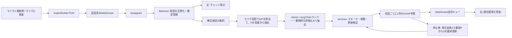

# チャット風文字起こしとリアルタイムSOAPの実装計画

作成日: 2026-11-15。実装前の計画。
基準: `93ae4105` の文字起こし機能。並行して実装中のSupabase Auth導入後に統合する。

## 目的と決定事項

- 認証必須の `/transcription` を、会話とSOAPを同時に確認できる作業画面にする。
- FHD相当の画面では左50%がチャット風の文字起こし、右50%がSOAP。
- 1会話につきSOAPは1件だけ持ち、その内部にS・O・A・Pをそれぞれ1欄ずつ固定して表示する。
- マイク1を薬剤師、マイク2を患者に固定する。薬剤師の発言をP、患者の発言をSの入力元とする。Oは両者の会話から抽出する。Aは薬剤師が述べた評価から会話中にも更新し、停止時には最新のPからの推測を加えて最終更新する。
- 各欄には複数の要素を置ける。会話に応じて要素を追加・修正・撤回し、更新のたびに新しいSOAPを積み重ねない。
- Deepgramの認識結果をBackendで処理し、LangChainで包んだLLMを通してSOAP要素を生成する。更新結果はWebSocketで画面へ配信する。
- LLMのプロバイダー・モデルは未定。特定ベンダーのSDK型をサービス層やFrontendへ漏らさない。
- 既存の医療向けM3テーマ、収音・認証・キャンセル・末尾PCM送信・最終結果待機を維持する。
- 今回作成するのは計画書だけとし、並行実装中の認証コードは変更しない。

## 1. 画面の設計

```text
┌───────────────────────────────────────────────────────────────┐
│ 共通ヘッダー                                      アカウント │
├───────────────────────────────────────────────────────────────┤
│ 会話の状態  薬剤師 / 患者  マイク設定       開始 / 停止       │
├───────────────────────────────┬───────────────────────────────┤
│ 文字起こし                    │ SOAP                     下書き│
│                               │                               │
│ 薬  薬剤師                      │ S 主観的情報                  │
│ ┌───────────────────────┐     │ ・会話から抽出した情報        │
│ │ 発話テキスト          │     │                               │
│ └───────────────────────┘     │ O 客観的情報                  │
│                     患者  患  │ ・会話から抽出した情報        │
│     ┌───────────────────────┐ │                               │
│     │ 発話テキスト          │ │ A 評価                        │
│     └───────────────────────┘ │ ・薬剤師の評価＋最終推測          │
│                               │                               │
│ 薬  認識中の文章…              │ P 計画                        │
│                               │ ・薬剤師の発言を整理          │
│         ↓ 新しい発話          │ 更新中 / 最新の反映状況       │
└───────────────────────────────┴───────────────────────────────┘
```

### レイアウト

- 基準のCSS viewportは1920×1080、100%表示。ブラウザのツールバー・OSの表示倍率による差も考慮する。
- ページ幅の既存上限を作業画面だけで見直し、横幅を使う。余白と境界を除いた利用可能幅を `minmax(0, 1fr)` の2列へ等分する。
- 共通ヘッダーとコンパクトな操作バーを上部へ置き、残りの高さを作業領域へ割り当てる。紹介用のヒーローはこのページに置かない。
- 文字起こしとSOAPは別々にスクロールする。SOAP内の4欄は縦に並べ、4欄それぞれにスクロール領域を作らない。
- `min-width: 0` / `min-height: 0` を適切に設定し、長文で画面全体が横へ広がらないようにする。
- 1024px未満では「文字起こし / SOAP」の切り替え表示にする。隠れた側も状態を保持し、処理は継続する。200%拡大や1536×864相当でも操作を確認する。
- 初版は50:50固定。幅をドラッグ調整する機能は後続とする。

### 左側: チャット風文字起こし

- 薬剤師（マイク1）は左寄せ・青緑、患者（マイク2）は右寄せ・ブルー。本文はどちらも左揃えにして読みやすさを保つ。
- 各発話に「薬剤師／患者」の役割名・マイク番号・時刻を持たせる。色だけで区別しない。
- 役割はユーザー指定の固定割当てとして扱い、LLMの話者推定に任せない。表示名を変更しても役割・SOAP入力先は変えない。収音中のデバイス切り替えを抑止し、入れ替える場合は停止して割当てを確認する。
- 同一デバイスを両方のマイクに指定する操作を拒否する。初版のSOAP生成は2マイク構成を対象とし、既存の1マイク文字起こしでは薬剤師と患者を自動分離したことにしない。
- 同じ話者の連続発話は表示上まとめるが、内部の認識セグメントIDと根拠の対応は保持する。別話者の発話を挟んだものはまとめない。
- interimは同じ発話枠内で更新し、確定時に置き換える。途中結果ごとに吹き出しを増やさない。
- 両者が同時に話した場合も時系列の単一リストへ表示する。表示順を認識結果の到着順だけで決めず、音声時刻と安定したIDで扱う。
- 最下部を見ている場合だけ自動追従する。過去を読んでいる間は位置を奪わず「新しい発話」を表示する。

### 右側: 1件のSOAP

- S・O・A・Pの見出しは常に存在する。情報のない欄は空の状態として表示し、「異常なし」「特記なし」を自動補完しない。
- 要素は安定したIDを持ち、更新してもカードや行を作り直して増殖させない。
- 変更された要素だけを短時間強調する。更新中も直前の内容を消さず、SOAP側のスクロール位置も維持する。
- 各要素から根拠となった発話へ移動できるようにする。複数根拠の場合は一覧を開く。
- 「下書き」「更新中」「更新失敗」「未反映の会話あり」を表示し、認識確定とSOAP内容の確認済み状態を混同しない。
- 初版はSOAP本文を読み取り専用とし、コピーできるようにする。手修正とAI更新の競合制御は後続に分ける。
- SOAPの見た目・空状態・更新中・失敗・長文をStorybookで確認する。共有UIへLLMや認証の処理を入れない。

## 2. マイク・SOAPの割当て

| 欄 | 入力元 | 実行時期 | 処理 |
|---|---|---|---|
| S | マイク2・患者 | 会話中に更新 | 患者の訴え、服薬状況、質問への回答等を整理する |
| O | 両方のマイク | 会話中に更新 | 会話に明示された検査値、測定値、処方情報等を抽出する |
| A | 薬剤師の発言、および最終的なP | 会話中＋停止後 | 会話中は述べられた評価を抽出し、停止時にP由来の推測を加えて最終更新する |
| P | マイク1・薬剤師 | 会話中に更新 | 薬剤師が述べた指導・対応・計画等を整理する |

- Deepgramの`channelIndex=0`を薬剤師、`channelIndex=1`を患者へ対応させ、Backendで役割とS/Pの入力先を固定する。
- S/Pは指定された側の発言を候補入力とする。元の発言はチャットへ残し、LLMが挨拶や質問を勝手に指導計画・事実へ変換しない。薬剤師が質問しただけの内容を患者の申告としない。
- Oは両者から抽出するが、患者の発言だから客観的に検証済みとは扱わない。自己測定・伝聞・薬剤師の確認等、情報源の性質を保持する。数値と単位を補作しない。
- Aは「薬剤師が発言した評価」と「Pから推測した評価案」を区別して保持・表示する。前者も発言として確認できた情報であり、臨床的に検証済みであることを意味しない。新しい診断や未発言の治療計画を確定事項として追加しない。
- 会話中のA抽出では薬剤師の確定発話を入力する。Pが空でも薬剤師が評価を述べていればAを更新できる。単なる質問・挨拶・患者の発言から、薬剤師が評価したことを作り出さない。
- 停止時のA最終更新には現在のAと最新のPを渡し、P要素のID・版と根拠発話を添える。Pが空なら推測は行わず、発言由来のAを維持して推測の材料不足を示す。
- 会話中はS/O/Pとともに、薬剤師の発言由来のAも更新する。録音停止時には最後の発話まで同期した後、Pに基づく推測を含むAの最終更新を1回行う。会話中・停止時とも、同じA欄の要素を更新する。
- 最終更新で発言由来の評価を単に削除したり、Pからの推測で上書きしたりしない。訂正や矛盾がある場合は根拠を保持し、推測側を要確認として扱う。
- 再開後も薬剤師が述べた評価をAへ随時反映する。Pが変わった場合は、以前のAのうちP由来の推測を「Pの更新後は未反映」とし、次の停止時に再検討する。発言由来のAは、その根拠発話の版で有効性を判断する。

## 3. データフローと責務



- 音声転送、Deepgram受信、LLM処理、ブラウザへの送信を別の非同期処理にする。
- Deepgramの受信ループでLLMの完了を待たない。SOAP生成が遅くても文字起こしを継続する。
- WebSocketへの書き込みは1つのwriterへ集約する。同じ接続へ複数タスクが直接書き込まない。
- LLMの処理待ちは会話ごとにまとめ、実行中は新しい確定発話をpendingとして保持する。発話数分のLLM呼び出しを無制限に並べない。
- 認証失敗時はDeepgramにもLLMにも接続しない。LLMだけが利用不能な場合は文字起こしを継続し、SOAPの停止状態を示す。

## 4. 発話とSOAPの状態モデル

### 識別子

- `conversation_id`: 画面上の1会話を識別するID。
- `stream_id`: WebSocket接続・収音再開ごとのID。音声時刻が0へ戻る接続を区別する。
- `segment_id` / `segment_revision`: 発話セグメントとその修正。
- `transcript_revision`: 会話内の認識テキストの変更ごとに進む番号。
- `soap_id`: 会話内で1つだけのSOAP。S・O・A・Pを個別のSOAPとして作らない。
- `soap_revision`: SOAPを一括更新したときに進む番号。

Backendを発話とSOAP状態の正とする。現在Frontendにあるセグメント確定・回り込み判定は、Backendで同じポリシーを再現してから移す。画面とLLMが別々の発話集合を使わないようにする。

Backendでは受信PCMからチャンネルごとの音量履歴を求め、音声時刻と対応させる。既存の「無音を重複とみなさない」「重ならない相槌を残す」等のテストを移植する。除外候補の元発話は処理中の根拠として追跡できる状態を保つ。

### SOAP要素

```text
SoapNote
  soap_id, conversation_id, revision, processed_transcript_revision
  sections
    S: { revision, items: [...] }
    O: { revision, items: [...] }
    A: { revision, items: [...], derived_from_plan_revision }
    P: { revision, items: [...] }

SoapItem
  item_id, item_revision, text
  evidence: [{ stream_id, segment_id, segment_revision, quote, speaker_role }]
  origin: conversation | plan_inference
  derived_from_plan_items: [{ item_id, item_revision }]  # Pから推測したA要素だけに付与
```

- 発話にはBackendが割り当てた`pharmacist / patient`とS/Pの入力先を持たせる。LLM出力で役割を変更させない。
- Aの発言由来要素には薬剤師の発話を、P由来の推測要素にはPの要素ID・版を記録する。推測部分の基準となったPの版が現在と一致するかを検査する。
- 4欄を必須とし、欄の追加・削除は認めない。欄内の要素数は可変。
- 要素IDはBackendが発行する。LLMが既存要素を更新・撤回するときは、有効な既存IDだけを参照できる。
- LLM出力は追加・更新・撤回の操作候補と根拠を返す。Backendで検証してから、1回のSOAP更新として原子的に適用する。
- 出力に既存要素が含まれなかっただけでは削除しない。撤回には、訂正・否定などの根拠を要求する。
- 欄の移動も、旧要素の撤回と新しい欄への追加を同じ更新で行う。
- 手修正を追加する場合は、ユーザー確定・ロック・AI提案の扱いを先に定義し、自動生成で上書きしない。

## 5. LangChainラッパーと生成ルール

### 配置

- `backend/app/clients/soap_llm_client.py`: LangChainとプロバイダーSDKを隔離するアダプタ・Protocol。
- `backend/app/schemas/soap.py`: SOAP、根拠、操作候補、WebSocketイベントのPydanticモデル。
- `backend/app/services/soap_service.py`: 入力の組立て、検証、差分適用。
- `backend/app/services/conversation_service.py`: 発話状態とLLMスケジュールの管理。
- `backend/app/services/transcription_service.py`: 既存の認証・音声中継と会話処理の接続。
- `frontend/src/shared/lib/conversation/`: WebSocketイベントの型・検証・reducer。
- `frontend/src/features/transcription/`: 会話状態と画面の接続。
- `frontend/src/shared/components/transcript-chat/`, `soap-panel/`: Propsだけで描画する部品とStorybook。

クライアント層はJSON互換の入出力を返し、サービス層でPydantic検証する。LangChainのメッセージやRunnableをサービス層へ漏らさない。`init_chat_model` 等の選択処理と、構造化出力のプロバイダー差分はラッパー内で扱う。

LLM設定はBackendの環境変数に集約する。プロバイダー・モデル・タイムアウト・生成上限を指定できるようにする。必要な連携パッケージは、採用プロバイダーが決まった時点で追加する。初期の実装・テストにはFakeクライアントを使えるようにする。

### LLMへ渡す情報

- 現在のSOAP、今回までに処理した発話番号、新しい確定発話、必要な過去の根拠。
- マイク1＝薬剤師＝P、マイク2＝患者＝Sの固定対応。Oは両者から抽出し、Aは会話中の薬剤師の評価抽出と、停止時のP由来の最終推測を分ける。
- 明示的なJSON Schemaと、追加・更新・撤回に関する制約。
- 発話内容は処理対象のデータとして渡し、会話中の「指示を無視して」等をシステム命令として扱わない。

会話中の処理はS/O/Pの整理・記録と、薬剤師が述べた評価のAへの抽出を行う。停止時は既存のAを保持しながらPからの評価案を推測し、Aを最終更新する。患者の申告と測定・確認済み情報を区別し、診断・処方・測定値・用量を補作しない。停止時のA最終更新のモデル出力でS/O/Pを変更させない。推測したAは下書きの評価案として扱い、検証済みの事実や確定診断とは表示しない。

否定、疑い、過去と現在、訂正、数値・単位を保持する。根拠のない要素、存在しない発話参照、不正なスキーマは適用しない。構造化出力の成功だけで内容の正しさを保証したとは扱わない。

### 生成タイミングと同時更新

- interimは左側の表示だけに使う。LLMへ確定情報として送らない。
- `is_final` の発話を蓄積し、`speech_final` を発話のまとまりを判断する補助に使う。両フラグを同じ意味として扱わない。
- 初期値案: debounce 500ms、最大集約待ち2秒、生成開始の最短間隔2秒、LLMタイムアウト15秒、再試行1回。実測後に調整する。
- 実行中に発話が増えたらpendingをまとめ、完了後に未処理分を含む入力で次を実行する。短い「はい」「違います」等も勝手に捨てない。
- 会話中の`extract_soap`と停止時の`finalize_a_from_p`を別のタスク・出力スキーマとして検証する。Sは患者、Pと発言由来のAは薬剤師を主根拠とすることをBackendでも確認する。停止時の推測はPの要素を根拠にする。
- 生成開始時の`base_soap_revision`と入力に使ったセグメントの版を記録する。
- 会話・接続世代・SOAPの基準版・根拠の版が有効な結果だけを適用する。新しい発話が届いただけでは結果を捨てず、処理済み範囲を進めて次を生成する。これにより連続会話中の更新停止を防ぐ。
- 根拠そのものが訂正・撤回された場合は古い生成結果を破棄し、再生成する。
- 重要な過去情報を失わないよう、現在のSOAPと根拠を含む入力を構成する。トークン上限で根拠が収まらない場合は黙って切り捨てず、SOAP更新を保留して表示する。
- 使用量上限・処理待ち上限を設ける。上限到達時も文字起こしと最後のSOAPを残す。無断で別のプロバイダーへ送信し直さない。

## 6. WebSocketのイベント契約

認証中の`Auth` / `AuthOk` / `Error`と、現在の正常終了フローを維持する。その後の会話イベントをバージョン付きの共通形式にする。既存クライアントとの移行方法を認証実装担当と合わせ、認証フレームをLLMへ渡さない。

| イベント | 用途 |
|---|---|
| `TranscriptUpdated` | Backendで正規化した発話の作成・更新。ID、版、話者、音声時刻、interim/finalを含む |
| `SoapStatus` | 待機・生成中・反映済み・失敗・未反映の有無 |
| `SoapUpdated` | 検証・適用済みのSOAP全体と、変更／撤回した要素ID |
| `ConversationSnapshot` | 現在の発話とSOAPを整合した状態で渡す |
| `ConversationCompleted` | 最終発話と、可能な範囲の最終SOAP更新が完了したことを通知 |

各イベントに`protocol_version`、`conversation_id`、`event_id`、単調増加する`sequence`を付ける。SOAPには`soap_revision`と`processed_transcript_revision`を含める。Frontendは別会話・旧世代・重複・逆順の更新を無視する。

初版の`SoapUpdated`は4欄すべてを含む完全なスナップショットとする。画面では要素IDで差分を当てるため、毎回SOAPを追加する動作にはならない。未完成のJSONやLLMトークン列を直接本文へ反映しない。

LLMの操作候補をFrontendが独自に適用する方式にはしない。大きなSOAPで差分イベントが必要になった場合は、基準版・適用後の版・再同期を定義してから拡張する。

送信キューは上限を設ける。interimやSOAPの待機中スナップショットは最新へまとめられるが、確定発話を黙って捨てない。受信が追いつかない場合はエラーと終了／再同期方針を明示する。

## 7. 停止・切断・保存の扱い

- 通常停止は「PCMのflush → Deepgramの最終結果 → S/O/Pと発言由来Aの最終同期 → 既存Aと最新PからAを最終更新 → 完了通知」の順にする。Pの最終同期に失敗した場合は、古いPから推測して最新扱いにせず、推測を含むA最終更新を保留する。最後に受信できた発言由来Aと既存SOAPは保持する。
- 既存のSTT終了待機と、追加するLLM終了待機を分けて期限を設ける。LLMが間に合わなければ、確定発話と直前のSOAPを残して未反映を示し、停止を無期限に待たせない。
- SOAPを有効にした経路では、現在のFrontendの終了待機6秒をそのまま使わない。初期値案はSTT最大5秒＋発言の最終同期とA最終更新を合わせた総予算15秒＋通信余裕2秒とし、Frontendは最大22秒以内の完了通知／切断を待つ。最終同期では再試行しない。収音は先に止め、「SOAPを最終更新中」と表示する。
- DeepgramのEOFだけでブラウザとの接続を閉じない。会話の終了管理が残りのSOAP更新を処理し、`ConversationCompleted`を送ってから閉じる。Vercelの残り実行時間が不足する場合は、その範囲で打ち切りと未反映を通知する。
- 画面離脱・ログアウト・認証期限では収音を解放し、新しい外部処理を開始しない。生成中のリクエストをキャンセルし、遅れて返る旧結果を適用しない。
- Vercelの接続時間上限より前に終了処理を開始する。タイムアウト予算にはSTTとLLMの最終待機も含める。
- 「新しい会話」を明示的に開始したときだけ新しいSOAPを作る。マイク切り替えや認識結果の到着ごとにSOAP IDを変えない。
- MVPはページを開いている間の下書きを対象とする。切断後も最後の表示を保持するが、サーバー状態が復元できるまで自動更新を再開しない。
- 再読み込み・別端末・別インスタンスをまたぐ復元には永続化が必要。後続で`ConversationRepository`を用意し、Supabase Postgres等に所有者付きの会話・発話・SOAP版を保存する。プロセス内の辞書だけで復元可能とは扱わない。
- 永続化導入時は所有者検証・RLS・保存期間・削除・認証期限後の最終保存を別途設計する。初版で会話を無断でDBやlocalStorageへ保存しない。
- LangChainのトレース等へ会話本文を自動送信しない。通常ログは相関ID・処理時間・件数・使用量に限定し、トークンや会話本文を出さない。

## 8. 実装フェーズと受入条件

| フェーズ | 作業 | 受入条件 |
|---|---|---|
| 0: 統合条件 | 認証実装の完了点、WebSocket契約、ページの所有範囲を確認 | 認証担当の変更を上書きせず、認証成功後だけ会話処理を開始できる |
| 1: UI先行 | 左右50:50、チャット表示、固定SOAP4欄、Fake更新 | 1920×1080で両側を同時に読め、話者・変更要素が分かる。狭い幅でも操作できる |
| 2: 発話の正規化 | Backendの発話状態・ID・版・固定役割・音量履歴とイベント化 | 左の表示とLLMの根拠が一致し、途中結果・同時発話・訂正・回り込みを扱える |
| 3: SOAP生成 | LangChainアダプタ、S/O/P・薬剤師の評価の抽出と停止時のA最終更新、構造化出力、集約・検証・差分適用 | Fakeクライアントで要素の追加・更新・撤回ができ、不正出力では状態が壊れない |
| 4: WebSocket統合 | writer、版管理、ステータス、終了時の最終生成 | LLMが遅くても音声と文字起こしが止まらず、SOAPが増殖・巻き戻りしない |
| 5: 実モデル評価 | プロバイダー決定、モデル連携、精度・遅延・使用量評価 | 許可した評価用会話で根拠・否定・数値・訂正を確認し、目標と実測を記録する |
| 6: 継続利用 | 永続化、再接続・復元、必要なら手修正とロック | 所有者をまたいで混ざらず、再開後も同じSOAPを継続できる |

実装はテスト先行とし、まずFakeイベント／Fake LLMで表示と更新契約を確定する。認証の並行実装中はUI部品・Storybookと独立したSOAPスキーマの設計までに留め、共通のWebSocket処理への変更は統合後に行う。

## 9. 検証項目

- 画面: FHD、1536×864、1024px境界、390px幅、200%表示、明暗テーマ、キーボード、モーション低減、長文、空状態。
- 会話表示: 薬剤師／患者の固定位置と役割名、同じ話者の連続発話、同時発話、interim更新、読み返し中の自動スクロール抑止、根拠への移動。
- 割当て: マイク1→薬剤師→P、マイク2→患者→S、Oは両者、Aは薬剤師の評価から随時更新し、停止時は最新Pから最終更新。薬剤師の質問を患者の申告にしない。
- A: 会話中の薬剤師の評価を反映、Pが空でも発言由来Aは保持、停止時は最後の発言同期後に最終更新、発言と推測の区別、P根拠の追跡、推測による発言由来Aの上書き防止、再開後の随時更新と推測部分の未反映表示、古い最終更新結果の破棄。
- SOAP: 4欄が各1つ、安定した要素ID、追加・訂正・撤回、重複追加なし、空欄の維持、否定・疑い・時系列・数値と単位。
- LLM: 不正JSON、未知の欄・要素ID・根拠ID、拒否、タイムアウト、上限、再試行、長い入力、会話内の命令文、古い結果の到着。
- 同時更新: 生成中に発話が増える、根拠が訂正される、連続会話、停止中の最終発話、ログアウト、旧接続の遅延結果。
- 通信: イベント重複・逆順・別会話混入、遅いクライアント、キュー上限、認証失敗時の外部接続ゼロ。
- 性能: 確定発話からSOAP反映までのp50/p95、STT転送遅延、LLM呼び出し頻度、トークン使用量、キュー長を記録する。最初の目標は通常の短い発話で数秒単位の追従とし、モデル未定の段階で数値保証しない。
- 回帰: 既存の認証・1/2マイク・キャンセル・末尾音声・最終結果待機のテストを維持する。

コマンド: `pnpm check`, `pnpm test`, `pnpm build`, `pnpm test:e2e`, `pnpm test:storybook`。
実LLM・Deepgram・マイク・Vercelの確認はスタブ検証と分けて記録する。

## 10. 初版に含めないもの

自動診断・自動処方、電子カルテへの自動確定、検索/RAG、複数患者の同時処理、手修正の競合解決、永続保存、別端末への復元、LLMプロバイダーの無断切り替え。必要になった段階で受入条件を追加する。

## 参照

- [認証導入計画](supabase-auth.md)
- [Deepgram: endpointingとinterim results](https://developers.deepgram.com/docs/understand-endpointing-interim-results)
- [LangChain: Models](https://docs.langchain.com/oss/python/langchain/models)
- [LangChain: Structured output](https://docs.langchain.com/oss/python/langchain/structured-output)
- [SOAP Notes](https://www.ncbi.nlm.nih.gov/books/NBK482263/)
- [W3C: Use of Color](https://www.w3.org/WAI/WCAG22/Understanding/use-of-color.html)
- [Vercel: WebSockets](https://vercel.com/docs/functions/websockets)
